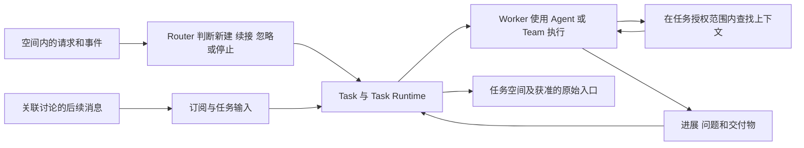

# Cimi Work PRD

版本：0.3  
日期：2026 年 11 月 2 日  
状态：需求草案

## 1 产品定义

**Cimi Work 是一个以 Task 为核心、Agent 为驱动的 AI Native 工作协作平台，让 Agent 围绕任务自主查找上下文、组织协作、推进执行并交付成果。**

用户提出目标，可以指定执行者，也可以交给系统判断。Agent 接到 Task 后，主动查找相关资料、理解工作背景、制定执行计划，并在需要时邀请其他 Agent 或人参与。目标、上下文、执行进展、协作讨论和交付成果始终关联到同一个 Task。

用户既可以在个人空间处理自己的工作，也可以在项目空间与成员共享任务和上下文。空间决定工作归属、资料范围和协作边界；任务空间是某个 Task 的工作界面。

### 1.1 产品目标

- 降低任务发起成本：用户不必先整理完整背景，也不必预先理解执行资源的分类。
- 让 Agent 主动推进工作：围绕目标发现上下文、组织执行，遇到真正的阻塞再请求协作。
- 让工作过程可理解：用户随时知道任务进展、需要自己处理的事项，以及已经形成的成果。
- 完成交付闭环：任务从目标出发，经过执行、协作和验收，最终形成可追溯的成果。

### 1.2 本版要回答的三个产品问题

| 产品问题 | 本版需求结论 | 详细定义 |
| --- | --- | --- |
| 创建 Task 时最少必填哪些信息 | 在个人或项目空间只要求用户填写目标；所在空间与发起人自动带入，材料、验收要求和执行方式均可选 | 第 3 节 |
| 系统自动判断要输出哪些信息 | 结合空间范围和事件来源，判断新建还是续接任务；展示执行者、目标理解、计划、上下文和交付预期 | 第 4 节 |
| 任务空间默认展示哪些状态和交付物 | 展示归属空间、任务状态、进展、需要人的事项和最新成果；讨论、上下文和执行记录支持展开 | 第 5 节 |

## 2 工作对象与用户流程

### 2.1 核心对象

| 对象 | 产品职责 |
| --- | --- |
| 空间 Space | Task、资料、执行资源与接入规则的归属和访问边界，分为个人空间和项目空间 |
| 个人空间 Personal Space | 承载个人任务、资料和连接器，默认仅本人可见 |
| 项目空间 Project Space | 承载项目成员共同工作的任务、资料、讨论和执行资源 |
| 任务 Task | 一次以目标和交付结果为边界的工作单元，持续承载执行与协作 |
| Agent | 理解目标，自主查找上下文，制定计划、调用能力并推进任务 |
| Team | 承担需要多个 Agent 配合完成的工作，对外呈现统一的执行进展和成果 |
| Harness | 为执行提供流程、工具与运行约束，可按任务需要配置 |
| 任务空间 | 人与 Agent 围绕一个 Task 共同工作的界面 |
| 交付物 Artifact | 任务生成的文档、表格、代码、文件或其他可查看的结果 |

执行方案由执行者、所需流程和运行环境共同组成。Agent 或 Team 回答“谁来执行”，Harness 回答“如何组织执行”，Sandbox 回答“是否需要独立运行环境”。普通用户可以使用默认方案。

### 2.2 主要角色

| 角色 | 主要操作 |
| --- | --- |
| 发起人 | 提交目标、补充约束、查看进展、验收成果 |
| 人类协作者 | 接受协作邀请，提供资料、判断或专业意见 |
| 执行 Agent 或 Team | 主动取得上下文、推进执行、请求协作和提交成果 |
| 项目负责人 | 查看项目任务、识别阻塞并协调参与者 |
| 空间所有者或管理员 | 管理本空间的成员、资料接入、执行资源和主动接单规则 |

### 2.3 主流程

1. 用户在个人或项目空间输入目标并创建 Task；已启用的事件来源也可以提出工作候选。
2. 系统判断任务归属与是否需要新建；对已有任务的后续输入，续接原 Task。
3. 对需要启动的任务，采用用户指定的执行者，或自动匹配所在空间可用的 Agent 或 Team。
4. 执行 Agent 在任务授权范围内自主查找上下文，形成目标理解、执行计划和预期成果。
5. 条件具备时直接执行；缺少关键输入时，在任务空间提出具体问题。
6. 执行过程中持续接收相关事件，更新进展，按需邀请其他 Agent 或人参与。
7. Agent 提交成果和验收说明，Task 进入待验收。
8. 发起人接受成果，或提出修改要求；修改继续在同一 Task 中进行。

整个流程保留同一个任务标识和工作记录。补充资料、协作和返工不要求用户重新创建任务。

### 2.4 个人空间与项目空间

| 维度 | 个人空间 | 项目空间 |
| --- | --- | --- |
| 默认建立方式 | 用户首次进入时自动拥有一个个人空间 | 用户主动创建项目，并邀请成员 |
| 主要用途 | 个人委托、调研、材料整理和未进入项目的工作 | 多人围绕共同目标持续协作 |
| 任务归属 | Task 归属于个人空间，不要求关联项目 | Task 归属于当前项目空间 |
| 默认可见范围 | 仅本人 | 当前项目成员；受项目角色约束 |
| 上下文 | 个人资料、个人历史 Task、个人已授权连接器 | 已共享的项目资料、项目讨论、项目历史 Task 和项目连接器 |
| 执行资源 | 个人可用的 Agent、Team 与环境 | 已向本项目开放的 Agent、Team 与环境 |
| 人工参与 | 默认由本人接收提问和验收 | 由发起人、指定协作者或项目负责人接收对应事项 |
| 主动接单规则 | 由本人配置，只作用于个人空间 | 由项目管理员配置，只作用于该项目 |

每个 Task 只有一个归属空间。项目空间是共享工作的容器，任务空间是其中一个 Task 的界面，二者不增加嵌套的成员体系。

### 2.5 上下文与共享边界

- 自主检索默认限于 Task 所在空间已开放的资料和当前执行授权；拥有检索能力不等于可以读取所有空间。
- 项目 Task 不因发起人拥有个人资料，就自动取得其个人空间内容或个人连接器的访问权。
- 跨空间使用材料时，由有权分享的人明确发布选定内容，并建立来源记录；不能只凭发起人同时属于两个空间就共享。
- 向项目发布个人成果时，用户选择目标项目和要共享的目标、材料或成果，预览后创建项目 Task。原个人 Task 保持原归属；未选择的私有消息和资料不随之公开。
- 个人成果与项目任务之间的来源关系也遵循可见范围，项目成员不能通过来源链接反查私有任务内容。
- 空间成员或资源授权发生变化时，后续检索、事件投递、任务恢复和对外写入均检查当前有效权限。

### 2.6 导航与我的工作

主导航包含“我的工作”“个人空间”和用户有权访问的项目空间。切换空间时，任务、资料和执行资源列表同步切换，并持续显示当前空间名称。

“我的工作”汇总本人发起、参与或需要处理的个人及项目 Task，每条任务标明归属空间。该视图不复制任务、不改变权限，也不是一个新的共享空间。失去项目访问权后，该项目内容不再出现在汇总中。

## 3 产品问题一 创建 Task 最少需要什么

### 3.1 创建入口

个人空间和项目空间均提供“新建任务”。创建区域默认展示当前空间、目标输入、添加材料和可展开的执行方式；主要操作为“创建任务”。

从空间内创建时自动使用当前空间。从“我的工作”等全局入口创建时，默认使用个人空间，用户可以在提交前改为有权创建任务的项目空间。不要求用户为了发起个人任务先建立项目。

用户可以只输入一句目标。复杂任务也可以直接补充详细要求，平台不限制目标的表达形式。

### 3.2 字段要求

| 字段 | 是否要求用户填写 | 默认值与处理规则 |
| --- | --- | --- |
| 任务目标 | 必填 | 说明希望完成的工作；空白内容不能提交 |
| 所属空间 | 自动带入，可修改 | 使用当前个人或项目空间，并展示名称；全局入口默认个人空间 |
| 所属项目 | 项目空间自动带入 | 个人 Task 不要求项目；切换到项目空间后使用该项目 |
| 任务标题 | 自动生成 | 根据目标生成简短标题，用户可以修改 |
| 输入材料 | 可选 | 支持添加文件、链接或项目内对象；没有材料也可以创建 |
| 验收要求 | 可选 | 用户可明确指定；未填写时由 Agent 根据目标生成，并在任务概览中展示 |
| 执行者 | 可选 | 默认“自动选择”；可指定 Agent 或 Team |
| 执行配置 | 可选 | 展开后可配置已有 Harness 或运行环境；未选择时由执行方案确定 |
| 截止时间 | 可选 | 有明确时间约束时填写；不填写不影响创建 |

任务标识、发起人、创建时间和初始状态由系统生成。资源访问范围依据所在空间和当前执行授权确定，不作为每次创建任务的重复填写项。提交后不能通过修改普通字段绕过跨空间发布流程。

### 3.3 提交后的默认行为

- 创建成功后立即进入任务空间，系统开始理解目标和确定执行方案。
- 自动选择是默认行为，不增加强制的“选择执行者”或“确认推荐方案”步骤。
- 任务目标存在歧义时，先利用可取得的上下文理解；仍有影响结果的关键分歧时再提问。
- 用户提交的材料作为明确输入保留。Agent 可以继续查找相关背景，不局限于用户主动附带的内容。
- 未找到合适执行资源时，保留 Task，说明原因，并提供重新选择或稍后重试的入口。

### 3.4 手动选择规则

手动入口显示当前可用资源的名称、能力说明和可用状态。不可用资源展示原因，不能被正常提交为可执行方案。

用户指定的执行者优先于自动匹配。若其能力、环境或访问条件不满足要求，平台说明具体问题；不静默替换为其他执行者。

任务开始后，在概览中持续展示实际执行者。需要调整时，通过明确的改派操作记录原执行者、新执行者及原因，避免产生两组并行且相互冲突的执行。

### 3.5 创建体验验收

在个人或项目空间已有可用执行资源的前提下，用户只填目标即可创建并进入执行流程。标题、验收要求、输入材料、Harness 和 Sandbox 均不能成为默认必填项。没有任何项目的新用户也能够在个人空间发起任务。

## 4 产品问题二 系统如何判断并自主推进

### 4.1 自动判断的输入

系统根据任务目标、用户补充的约束、所在空间的上下文，以及可用执行资源的能力判断执行方式。对事件产生的候选，先判断是否应启动工作，或是否属于已有 Task 的后续输入，再判断执行方式。

判断分两步完成：先利用创建时已有的信息选出执行者，再由执行 Agent 主动查找上下文，完善方案。上下文发现的新约束应反映到后续计划中。

### 4.2 自主查找上下文

自主查找上下文是首版核心能力。Agent 接到 Task 后，应主动完成以下动作：

1. 读取当前目标、验收要求、用户材料和任务内已有消息。
2. 在个人空间查找相关个人资料和历史 Task；在项目空间查找共享资料、讨论、历史 Task 及其成果。
3. 根据任务需要，检索所在空间已接入且在任务授权范围内的外部资料源。
4. 判断资料之间的关联，形成与本次目标有关的工作背景。
5. 将实际采用的重要来源关联到 Task，并区分资料事实与执行假设。
6. 确实缺少关键输入时，再向用户或相关协作者提出问题。

检索范围随任务推进而更新。用户补充要求、Agent 发现新依赖，或协作者提供资料时，执行 Agent 应继续获取必要上下文。

| 情况 | 要求的行为 |
| --- | --- |
| 所在空间的可访问资料中已有答案 | 自主读取并使用，避免要求用户重新粘贴 |
| 找到多份相关资料 | 结合时间、版本及任务要求判断适用性；影响结果的冲突需说明 |
| 资料无法访问 | 显示无法访问的来源和影响，不将其描述为已经读取 |
| 未查到必要信息 | 说明缺少什么、已经查过哪些范围，以及需要谁补充 |
| 缺少非关键背景 | 可以声明必要假设并继续推进，不因每个细节都等待用户 |
| 用户明确限定资料范围 | 在指定范围内查找和使用 |
| 答案可能位于未开放的个人或其他项目空间 | 不自动跨空间读取，提出具体材料需求或使用已明确共享的内容 |

任务空间默认展示重要来源摘要，详细来源和使用记录可展开查看。用户不需要逐条批准普通资料检索。

### 4.3 自动判断结果

以下信息写入任务空间，并随实际执行更新。它们是工作说明，不构成额外的强制审批表单。

| 信息 | 展示内容 | 要求 |
| --- | --- | --- |
| 目标理解 | Agent 理解的工作目标和完成边界 | 始终可查看；发现歧义时明确提出 |
| 执行者 | 实际承担任务的 Agent 或 Team | 显示名称及简短选择理由 |
| 工作来源 | 用户创建、事件候选或已有任务的后续输入 | 保留来源和判断结果；说明新建或续接的依据 |
| 执行计划 | 主要步骤、当前步骤和必要依赖 | 使用用户能理解的工作描述 |
| 上下文 | 已采用的关键来源、仍在查找的资料及缺失项 | 区分已取得、待查找和无法访问 |
| 预期交付 | 将交付什么，以及如何判断完成 | 用户要求优先；系统补充内容可调整 |
| 运行环境 | 使用的 Harness，以及是否需要 Sandbox | 有环境需求时展示；普通信息默认收起 |
| 时间预期 | 有依据的预计耗时或主要不确定性 | 无依据时不生成确定数字 |
| 待处理事项 | 需要人提供的资料、选择或授权 | 明确问题、处理入口及阻塞的步骤 |

执行方案发生实质变化时，更新当前展示并保留关键变更记录，不要求用户从完整聊天中自行推断。

### 4.4 Agent 组织协作

执行 Agent 对 Task 的推进负责。需要其他能力时，可使用已接入的协作资源，向其他 Agent 委派明确的工作，并接收结果。

协作请求至少携带子目标、必要上下文和期望输出。协作产出回到原 Task，由负责推进的 Agent 汇总；内部完成一个子任务，不代表整个 Task 已完成。

需要人的判断时，Agent 在任务空间创建协作事项，说明问题、相关材料、可选判断和预期反馈。已有明确协作者时定向邀请；没有明确对象时交给发起人协调。

不阻塞目标的协作事项允许其他步骤继续执行。若所有可推进的工作都被阻塞，任务转入待协作。人的回复必须进入执行上下文，驱动后续工作。

### 4.5 执行异常

| 异常 | 产品行为 |
| --- | --- |
| 没有合适的执行者 | 保留任务，展示原因和重新选择入口 |
| 必要输入或权限缺失 | 提出具体协作事项；阻塞时进入待协作 |
| 执行资源中断或工具失败 | 展示失败步骤、已有成果及可用的重试操作 |
| 重试执行 | 创建新的执行记录，继续关联原 Task；重复执行前检查是否已产生结果 |
| 用户取消 | 发出停止请求；停止完成后显示已取消，保留已有记录和成果 |

实际停止尚未完成时，显示“正在取消”，不提前宣称执行已经停止。

### 4.6 Super-Agent 架构的采用方式

Cimi Work 采用空间内路由与具体任务执行分离的方式。Router 负责识别新工作和分派，Worker 围绕 Task 持续执行。这个分工参考 DeepSeek 官方原型中的主 Session 与 Executor Session；执行上下文按任务组织。[执行机制参考](https://github.com/deepseek-ai/dsh-superagent-prototype/blob/6337fc8/docs/003-execution.md)

个人与项目空间分别保留独立的逻辑路由上下文和规则；底层服务可以共享基础设施，但不混用资料、订阅和授权。这是 Cimi Work 的空间设计。

| 层次 | Cimi Work 职责 | 对用户的表现 |
| --- | --- | --- |
| 事件接入 Source | 接收空间内创建、消息、评论和已接入来源的事件 | 可以从工作发生的地方发起或继续任务 |
| 路由 Router | 区分新委托、已有任务补充、无须行动的信息和停止请求 | 避免每条消息都创建新任务 |
| Task Runtime | 保存任务、执行授权、输入、订阅、执行批次和待办 | 任务能够跨消息、跨运行持续推进 |
| 执行 Worker | 使用具体 Agent 或 Team 查找资料、推进工作并报告结果 | 用户围绕一个 Task 查看整体成果 |
| 结果回传 Channel | 将成果或具体问题送回任务及获准使用的原始入口 | 反馈能到达提出工作的人 |

每个来源实例在接入时绑定所属空间。事件的接收、路由、订阅和回传沿用这一归属，不根据消息中提到的项目名称自动切换空间。

事件、评估、任务、派工、订阅和回传的分离参考官方领域模型；Cimi Work 用 Task 承载面向用户的工作，并增加空间归属和人工验收规则，不要求用户学习另一套工单概念。[领域模型参考](https://github.com/deepseek-ai/dsh-superagent-prototype/blob/6337fc8/docs/001-domain.md)

Router、Worker 和执行批次属于平台内部机制，不增加为创建任务时的必选项。Super-Agent 是整体组织方式，不作为与 Agent、Team、Harness 并列的第四类执行者。

### 4.7 接单规则与主动工作

接收信息与获准执行分开处理。用户有权发起的明确委托正常启动；Agent 从讨论或其他事件中发现潜在工作时，先按所在空间的规则评估。普通资料内容不能修改接单规则或扩大访问范围。[授权机制参考](https://github.com/deepseek-ai/dsh-superagent-prototype/blob/6337fc8/docs/002-authorization.md)

| 模式 | 对主动发现工作的处理 | 对明确委托的影响 |
| --- | --- | --- |
| 关闭 | 不主动生成工作候选 | 有权发起的委托正常执行 |
| 观察 | 记录候选、理由和建议；不自动创建可执行任务 | 有权发起的委托正常执行 |
| 自动 | 仅对命中空间已启用规则的候选启动 Task | 有权发起的委托正常执行 |

首版默认观察模式。个人空间由本人管理，项目空间由管理员管理；启用自动模式时明确适用来源、工作范围和可执行动作。候选只进入可查看的记录，不逐条推送通知。

候选记录提供“创建任务”和“忽略”操作。有权发起人主动接受候选时，按明确委托创建 Task，不要求先把整个空间改为自动模式。

每次接单保留工作来源、发起依据、执行范围和所依赖的规则版本。后续消息可以补充上下文，但不能自行扩展为未获准的新工作；超出范围的请求交回 Router，按新委托判断。

### 4.8 连续执行与恢复

- Task 可关联多个讨论线程或成果反馈入口。相关后续消息通过订阅送回原 Task，不要求用户反复点名 Agent。
- 任务内属于原目标的跟进由当前 Worker 处理；属于其他工作或超出范围的请求交回 Router。
- 新事件依据来源和事件标识去重，不能因重复投递创建多个相同 Task 或重复执行同一动作。
- Task 与一次运行分开记录。等待外部事件、Worker 一轮结束或服务重启，均不等于任务已交付或已被验收。
- 运行中断后保存待处理输入和已有成果；恢复时先检查已完成的动作，再继续执行，避免重复发布或交付。
- 已完成 Task 收到有权发起人的实质修改要求时，可以重新进入执行并形成新交付版本；普通致谢不重启任务。
- 已取消 Task 不因订阅消息自动复活。恢复需要用户显式操作，并重新检查当前空间权限和执行范围。

上述连续性借鉴原型的后续输入与恢复机制；Cimi Work 保留“人工接受成果后完成”的产品规则，不直接套用编码原型的结束条件。[后续输入与恢复参考](https://github.com/deepseek-ai/dsh-superagent-prototype/blob/6337fc8/docs/003-execution.md)

### 4.9 减少对人的打扰

工作进展持续写入任务空间，通知只在需要具体输入、出现影响交付的阻塞或成果可验收时触发。同一问题与同一版本交付不重复提醒，相关问题尽量合并成一次可操作事项。

这一原则参考 DeepSeek 对人的注意力成本的设计要求；Cimi Work 的“我的工作”优先呈现本人需要处理的事项，同时仍允许查看全部相关任务。[设计原则参考](https://github.com/deepseek-ai/dsh-superagent-prototype/blob/6337fc8/docs/000-philosophy.md)

## 5 产品问题三 任务空间默认展示什么

### 5.1 信息顺序

任务空间默认让用户快速回答：现在进展到哪里、是否需要我处理、已经交付了什么。

| 区域 | 默认内容 | 主要操作 |
| --- | --- | --- |
| 任务概览 | 标题、目标、归属空间、执行者、当前状态和验收要求 | 查看完整目标、查看执行方案 |
| 当前进展 | 当前步骤、最近关键进展、最后更新时间 | 展开计划和执行详情 |
| 需要你处理 | 待补充问题、协作邀请、待验收事项 | 回复、选择、提供材料、验收 |
| 交付成果 | 最新可用产物、说明、版本和验收情况 | 打开、获取成果、提出修改 |
| 协作动态 | 人与 Agent 的消息和关键事件 | 发送消息、邀请协作者 |
| 上下文与记录 | 关键来源摘要，详细资料和执行记录默认收起 | 查看来源、查看执行历史 |

有待处理事项时，突出显示问题和操作入口；进入待验收时，突出显示成果和验收操作。详细日志不占用默认主要区域。

### 5.2 任务状态与操作

| 状态 | 含义 | 用户主要操作 |
| --- | --- | --- |
| 未开始 | 已创建，正在准备或等待执行资源 | 补充要求、选择执行者、取消 |
| 进行中 | Agent 正在查找上下文、规划或执行 | 查看进展、补充信息、参与讨论、取消 |
| 待协作 | 必要信息、决定或授权缺失，当前无法继续 | 回答问题、补充材料、邀请协作者 |
| 待验收 | Agent 已提交成果，等待发起人接受 | 查看成果、确认完成、提出修改 |
| 已完成 | 发起人已接受当前成果 | 查看成果和历史记录 |
| 执行失败 | 当前执行无法继续，需要重试或调整 | 查看原因、重试、调整执行方案 |
| 已取消 | 已按用户要求结束执行 | 查看已有记录和成果、显式恢复 |

“查找上下文”“制定计划”“生成成果”等作为进行中的步骤展示，不各自增加一个主要任务状态。

项目看板可以将待协作与待验收合并为“待确认”分组，但卡片必须标明具体原因。执行失败和已取消有独立的状态及筛选，不能归为已完成。

### 5.3 状态流转规则

- 未开始 → 进行中：执行资源开始处理 Task。
- 进行中 → 待协作：必要步骤被人的输入或决定阻塞。
- 待协作 → 进行中：阻塞条件解除，原任务继续执行。
- 进行中 → 待验收：交付物可查看，且 Agent 已提交结果说明。
- 待验收 → 已完成：发起人接受当前交付结果。
- 待验收 → 进行中：发起人提出修改要求，Agent 继续处理。
- 已完成 → 未开始：有权发起人提交原范围内的实质修改要求，通过恢复检查后开启新的执行批次。
- 未开始、进行中或待协作 → 执行失败：准备或执行过程出现无法继续的问题。
- 执行失败 → 未开始：用户发起重试或调整执行方案后重新准备。
- 未结束任务 → 已取消：取消请求完成，剩余执行已经停止。
- 已取消 → 未开始：用户显式恢复，且当前权限、执行范围和资源检查通过；历史订阅消息不自行触发恢复。

Agent 结束一次运行不自动将 Task 标记为已完成。任务执行、人工协作和成果验收分别保留自己的记录。等待外部事件显示在当前步骤中，不误报为等待人的回复。

### 5.4 交付物要求

每项交付物至少展示名称、类型、简短说明、产生时间、版本和可用的打开或获取入口。无法实际打开的内容，不能只用一句“已生成”作为交付。

成果区域默认展示本轮最新交付，历史版本可查看。修改产生新版本，保留此前成果及其反馈。

提交验收时，Agent 需要说明完成了哪些要求、成果在哪里，以及仍有哪些限制或未完成项。用户接受的是当前提交的成果版本；产生新的提交后，不沿用此前的接受记录。

### 5.5 人机协作要求

讨论消息、协作事项和验收反馈关联到 Task，并进入执行 Agent 的上下文。普通讨论不会自动改变任务状态；明确的回复、验收和修改操作触发对应流转。

需要用户处理的消息应同时形成可操作事项。用户能够看到谁需要回复、正在等待什么，以及处理后会继续哪一步。

首版通过任务空间和站内待办呈现协作事项。来源、订阅和结果回传首先覆盖站内任务与项目讨论；接入外部渠道后，在空间授权范围内回传到原始入口。邮件、外部即时通信等渠道不作为首期依赖。

## 6 关键使用场景

### 6.1 只给目标 自动推进

用户在项目中输入：“整理近期项目讨论，输出下一阶段需求清单和优先级建议。”

系统选择合适的 Agent。Agent 主动查找项目资料、近期讨论和历史任务，整理需求及其来源，再形成优先级建议。用户无需事先把这些背景逐条粘贴到任务里。

如果优先级依赖尚未确定的业务目标，Agent 提出具体问题；资料中已有答案时直接使用。最终在同一 Task 中提交需求清单、判断依据和需要进一步决定的事项，供用户验收。

### 6.2 指定执行者 多方协作

用户填写目标并指定已有 Team。Team 使用相关项目上下文组织工作，按需向其他 Agent 委派任务，或邀请人补充判断。

用户在原 Task 中查看整体进展和成果，不需要分别进入每个 Agent 的会话收集结果。无法满足所选执行方式时，平台说明原因并让用户调整。

### 6.3 成果修改与继续执行

用户查看交付物后提出修改要求。Task 回到进行中，Agent 读取原目标、已用上下文、旧成果和新反馈，继续修改。新成果以新版本提交，用户再次验收。

### 6.4 个人工作进入项目协作

用户在个人空间完成调研，随后决定让项目成员继续推进。用户选择要发布的结论和材料，并预览项目成员将看到的内容，再创建项目 Task。

项目 Agent 使用已经发布的材料和项目上下文继续工作。未发布的个人讨论、资料和连接器保持私有。两项 Task 分别保留个人与项目归属，在有权查看时才展示来源关系。

### 6.5 事件发现与任务续接

项目讨论中出现一个潜在问题。观察模式下，Router 记录候选和判断理由；自动模式下，只有命中项目规则且符合执行范围，才创建 Task。

后续在关联讨论里补充的复现条件送回原 Task。Worker 使用新增上下文继续处理，成果在任务空间提交，并回传到获准使用的原始入口。无需为每条补充消息重新创建任务。

## 7 首期交付范围

### 7.1 首期必须具备

| 编号 | 需求 | 交付要求 |
| --- | --- | --- |
| F01 | 空间与 Task | 个人及项目空间均可创建、查看、筛选 Task，每个 Task 具有唯一空间归属 |
| F02 | 极简创建 | 目标为唯一需要用户主动填写的字段 |
| F03 | 执行方式 | 支持默认自动匹配，以及指定已接入的 Agent 或 Team |
| F04 | 自主获取上下文 | 覆盖所在空间的可访问资料和历史 Task，记录关键来源，不越过空间范围 |
| F05 | 判断结果 | 展示执行者、目标理解、计划、预期交付及阻塞项 |
| F06 | 真实执行 | 调用实际执行资源，返回真实进展和可访问成果 |
| F07 | 协作推进 | 支持向已有 Agent 委派工作、向人请求输入，并将反馈带回原 Task |
| F08 | 任务空间 | 按第 5 节呈现进展、待办、成果、讨论和上下文 |
| F09 | 验收与修改 | 支持接受当前成果、提出修改、保留版本和再次提交 |
| F10 | 异常与取消 | 支持失败反馈、用户重试、取消及执行记录保留 |
| F11 | 空间共享边界 | 个人默认私有，项目按成员共享；支持选定个人成果发布到项目 |
| F12 | 我的工作 | 汇总本人相关任务与待办，显示归属空间，不扩大可见范围 |
| F13 | Router 与 Worker | 区分新建、续接、忽略和停止，将具体执行交给任务 Worker |
| F14 | 事件与订阅 | 站内来源事件去重，后续消息可送达原 Task，结果回到对应入口 |
| F15 | 主动接单规则 | 支持关闭、观察和自动模式，默认观察；按空间管理规则与执行范围 |
| F16 | 连续运行 | 任务与执行批次分离，保存待处理输入，支持中断恢复和完成后的合理续接 |

只展示实际可用的执行资源和运行环境。首期至少打通一种 Agent、一条已有 Agent 协作路径，以及个人和项目空间各一条上下文获取路径；不能用模拟进度代替真实执行。

### 7.2 后续扩展

- 更复杂的跨 Team 动态组织与 Matrix AgentTeams 接入。
- 更多 Harness、Sandbox 及外部上下文连接器。
- 外部业务事件和定时来源，以及可复用的任务模板。
- 更细的成本、预算和执行策略配置。

首期使用空间内已有授权和资源范围完成工作，具体接入清单由可用的执行资源及资料源决定。采用 Super-Agent 的职责分工不要求直接依赖某一家模型或 Harness；是否接入 DeepSeek 运行时另由适配方案确定。

## 8 验收标准

| 编号 | 验收场景 | 通过条件 |
| --- | --- | --- |
| AC01 | 只填写目标 | 个人及项目空间内仅填写目标即可创建；其余可选字段留空不阻止提交 |
| AC02 | 自动判断 | 不指定执行者时，系统使用可用资源并展示实际执行者和方案 |
| AC03 | 手动指定 | 指定可用执行者后按其执行；条件不满足时说明原因，不静默替换 |
| AC04 | 自主查找上下文 | 所需信息在当前空间可访问的资料或历史任务中时，Agent 主动取得并使用，不要求用户重复提供 |
| AC05 | 来源可追溯 | 关键来源可查看；未访问成功的资料不会被标记为已读取 |
| AC06 | 缺少信息 | 确实缺少关键输入时出现具体问题和处理入口；回复后原 Task 继续推进 |
| AC07 | Agent 协作 | 协作 Agent 收到必要目标和上下文，结果回到原 Task，由负责推进的 Agent 汇总 |
| AC08 | 默认视图 | 不展开完整聊天或日志，也能识别当前状态、最近进展、待办和最新成果 |
| AC09 | 真实交付 | 个人与项目空间分别完成至少一个使用本空间上下文的真实任务，并能打开或取得最终产物 |
| AC10 | 验收与返工 | 成果提交后待验收；接受后完成；要求修改后继续执行并形成新版本 |
| AC11 | 失败与重试 | 失败原因和已完成工作可查看；重试在原 Task 内产生独立执行记录 |
| AC12 | 取消 | 停止请求完成后才显示已取消，保留此前成果和协作记录 |
| AC13 | 历史恢复 | 刷新或重新打开任务后，状态、上下文引用、讨论和成果仍可查看 |
| AC14 | 无项目开始工作 | 新用户无需创建项目，即可在个人空间提交 Task |
| AC15 | 个人资料私有 | 其他用户不能查看个人 Task；项目 Agent 不能因发起人身份而读取其未共享的个人资料 |
| AC16 | 项目隔离 | 项目任务只使用本空间获准的资料；成员或资源权限变化后，后续读取与恢复遵循新权限 |
| AC17 | 我的工作 | 汇总视图显示本人有权访问的任务和归属，不复制任务，也不泄露已失去权限的项目内容 |
| AC18 | 发布个人成果 | 项目只收到用户选定并确认的内容，私有原任务及其消息不随之公开 |
| AC19 | 观察与自动模式 | 观察模式不自动执行候选；自动模式仅对命中已启用空间规则的候选启动任务 |
| AC20 | 后续消息续接 | 原任务关联讨论中的有效补充进入原 Task；越出原范围的新工作交回 Router |
| AC21 | 事件去重 | 相同来源事件重复到达时不重复建单、执行或回传同一结果 |
| AC22 | 完成后跟进 | 实质修改要求通过权限及范围检查后续接原 Task；致谢不触发执行，已取消任务不自动恢复 |
| AC23 | 中断恢复 | 重启后保留订阅、待处理输入及成果，继续前检查已完成动作，不重复对外提交 |

## 9 效果观察

| 指标 | 定义 | 用途 |
| --- | --- | --- |
| 目标式创建比例 | 既未补充材料、也未指定执行者的 Task 占全部创建 Task 的比例 | 观察极简入口是否被实际使用 |
| 自动匹配改派比例 | 自动匹配后被用户改派的 Task 占自动匹配 Task 的比例 | 观察执行者匹配是否合适 |
| 上下文补充原因 | 请求人工补充时，区分资料不存在、无法访问、检索未找到及需要人决定 | 定位自主获取上下文的不足 |
| 首次验收通过比例 | 首次提交即被接受的 Task 占已产生首次验收结果的 Task 的比例 | 观察对目标的理解及交付质量 |
| 交付与等待时长 | 分别记录从创建到首次提交、等待人处理、修改执行的时间 | 区分执行效率和协作阻塞 |
| 失败原因分布 | 按执行资源、工具、上下文、环境及其他原因统计 | 确定后续改进顺序 |

首轮以真实任务建立基线，再设定改进目标。指标记录应关联 Task、执行记录和交付版本，确保能够定位具体问题。

## 10 架构依据与采用边界

Super-Agent 相关设计以 DeepSeek 于 2026 年 10 月 31 日公开的研究原型为参考。官方 README 说明该原型面向单个 GitHub 仓库，不等同于正式产品，也未实现设计文章中的全部构想。[原型说明](https://github.com/deepseek-ai/dsh-superagent-prototype/tree/6337fc8)、[首次提交记录](https://github.com/deepseek-ai/dsh-superagent-prototype/commits/main/)

本 PRD 的个人与项目空间、任务归属、成果发布和人工验收是 Cimi Work 的产品设计。Router 与 Worker、事件续接、接单规则及运行恢复借鉴上述官方文档；这些需求定义不表示已完成 DeepSeek Harness 运行时或原型代码的接入。
