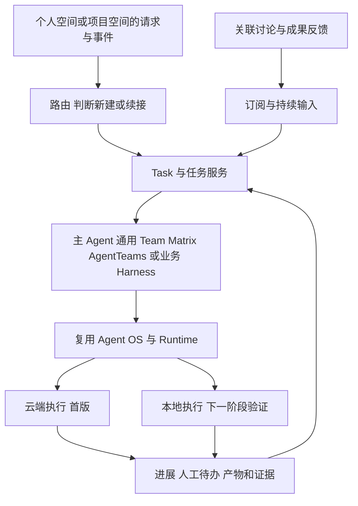

# Cimi Work PRD

版本：0.5

日期：2026 年 11 月 2 日

状态：需求评审稿

## 1 产品定义与目标

**Cimi Work 是一个以 Task 为中心、Agent 为驱动的 AI Native 工作协作平台：Agent 自主查找上下文，让人、云端与本地 Agent、Team 和业务 Harness 围绕共同目标平等协作，持续推进任务直至成果交付。**

Cimi Work 面向团队与 Agent 共同完成工作的过程。Task 是持续存在的协作空间，可以跨越数小时到数天，经历多次执行、人员参与、阶段回退和成果更新。目标、进度、讨论、决定、人工待办、产物与验收均关联到 Task。

个人空间承载私有工作，项目空间组织共同工作。两类空间使用同一个 Task 底座；不同业务通过执行机制和专业视图表达差异。

### 1.1 产品要解决的问题

| 问题 | 产品要求 |
| --- | --- |
| 任务登记与实际执行分散 | Task 直接连接执行机制，并持续接收进度、问题和成果 |
| 上下文需要反复转述 | Agent 主动查找空间资料、历史任务及获准使用的业务资源 |
| 人、Agent 与不同团队各自推进 | 围绕同一 Task 分工、交接、确认，维护共同的任务事实 |
| 运行结束后缺少交付闭环 | 成果、证据、验收结论和实际通知结果结构化保存 |

### 1.2 设计原则

- **Task 为中心**：任务承载持续协作，一次 Agent 调用只是其中一次执行。
- **Agent 驱动**：Agent 理解目标、获取上下文、提出计划并主动推进，需要判断或授权时再请求人参与。
- **平等协作**：人和 Agent 都能提供信息、提出方案、承担子任务、反馈问题并推动进展，各自遵守对应权限与职责。
- **执行可插拔**：支持单 Agent、通用 Team、Matrix AgentTeams 和业务 Harness，复用已有执行能力。
- **结果清楚、过程可追**：默认突出进度、待办和成果；专业任务可展开阶段、门禁、证据与回退。
- **权限约束贯穿执行**：空间可见、资源可读、动作可执行分别校验，协作邀请不自动扩大授权。

### 1.3 本版回答的三个产品问题

| 产品问题 | 需求结论 | 详细定义 |
| --- | --- | --- |
| 创建 Task 最少需要什么 | 目标必填；空间带入，材料、交付要求与执行方式可选；支持业务模板补充必要字段 | 第 3 节 |
| 系统自动判断什么 | 判断任务归属、续接关系、执行机制、所需上下文、环境、计划和交付预期 | 第 4 节 |
| 任务空间默认展示什么 | 展示整体状态、负责人、当前进展、人工待办与交付；按需展开协作、执行和专业阶段 | 第 5 节 |

## 2 空间与核心对象

### 2.1 个人空间与项目空间

| 维度 | 个人空间 | 项目空间 |
| --- | --- | --- |
| 定位 | 与项目并列的独立私有空间 | 多人、Agent 与执行机制共同工作的空间 |
| 默认建立 | 用户首次使用时拥有个人空间 | 用户主动创建项目，配置成员和资源 |
| Task 归属 | 个人 Task，不要求关联项目 | 归属于当前项目 |
| 可见范围 | 默认仅本人 | 按项目成员、角色及任务可见范围控制 |
| 上下文 | 个人资料、历史 Task、个人已授权连接器 | 项目规则、共享资料、讨论、历史决定与成果 |
| 执行资源 | 本人可使用的 Agent、Team、Matrix AgentTeams 与 Harness | 向项目开放的执行目录及默认执行机制 |
| 默认人工待办 | 本人处理，可按任务设置验收人 | 发起人、负责人或指定协作者处理 |
| 管理职责 | 本人管理资源、共享与空间规则 | 项目管理员管理成员、资源绑定及空间策略 |

每个 Task 有且只有一个归属空间。Task 工作台是任务的独立协作现场，不再形成与个人、项目并列的第三类空间。

“我的工作”汇总本人发起、负责、参与或待处理的 Task。每条任务标明归属空间，汇总不复制任务、不改变成员与资源权限。

默认首页为“我的工作”，优先展示待本人处理的事项与正在推进的任务，再进入个人或项目空间。

### 2.2 空间中的成员和资源

项目空间配置人员、角色、可用 Agent、通用 Team、小队、Matrix AgentTeams、业务 Harness，以及知识库、代码仓库、数据源、工具和连接器。目录只显示当前空间可使用的资源，资源详情说明能力、运行位置、可用状态与访问条件。

| 角色 | 职责 |
| --- | --- |
| 发起人 | 表达目标、提供约束，默认接收最终交付 |
| 任务负责人 | 关注整体推进，协调参与者，处理未明确归属的阻塞 |
| 参与者 | 人或 Agent，承担工作、补充资料、提出意见和反馈 |
| 任务协调者 | 主 Agent、Team 的协调角色或业务 Harness，组织计划、派工和交接 |
| 确认人或审批人 | 在指定范围内作出业务决定或批准具体动作 |
| 验收人或验收规则 | 判断当前成果是否达到任务交付标准 |
| 空间管理员 | 管理空间成员、资源绑定、默认执行方式与空间策略 |

简单任务默认由发起人兼任负责人和验收人，不要求重复选人。复杂任务可分别指定。Agent 可承担协调与执行职责，涉及人的决策权或资源审批仍按对应规则处理。

### 2.3 Task 与其他对象的关系

| 对象 | 定义与边界 |
| --- | --- |
| Task | 有目标、归属空间、负责人、参与者、进度和交付结论的持续工作对象 |
| Subtask | Task 内可独立分工、跟踪和提交结果的子工作，保留父子关系 |
| Execution 或 Run | 某次实际执行，记录执行机制、环境、状态、开始结束、错误与重试 |
| Harness Phase | 专业 Harness 的阶段、门禁和回退记录，例如产研 N1–N5 |
| Human Action | 有明确处理人和处理结果的人工确认、审批或验收事项 |
| Decision | 结构化的业务决定，记录提出者、决定者、时间、依据和适用范围 |
| Artifact | 文件、报告、表格、代码或 PR、业务结果、通知回执与相关证据 |
| 业务引用 | Task 关联的需求、缺陷、版本或其他业务对象，由业务扩展提供 |

一个 Task 可以有多个 Subtask、多个并行或先后的 Run、多个阶段与人工事项。一个 Run 成功不代表 Task 已验收；一个 Run 失败也不自动结束整个 Task。

子任务完成情况由任务协调者汇总。只有必需子任务、交付物和验收条件都满足时，父 Task 才能完成；可选子任务或已被替代的工作应说明处置结果。父任务取消时通知关联执行停止，未停止的执行明确展示，不能提前显示全部结束。具体聚合规则见第 11 节的待评审项。

### 2.4 执行机制

| 执行机制 | 承接工作的方式 | 典型使用 |
| --- | --- | --- |
| 单 Agent | 独立理解和执行，按需调用工具或请求协作 | 明确的分析、研究、文档或自动化任务 |
| 通用 Team 或小队 | 以多个角色协同完成目标，可固定配置并复用 | 跨角色分析、开发或综合任务 |
| Matrix AgentTeams | 通过已有 Matrix 协作机制组织 Agent 消息与群组交互 | 已基于 Matrix 运行的多 Agent 协作 |
| 业务 Harness | 以业务阶段、规则、门禁、回退和编排策略统筹整个 Task | Semi-loop 等专业产研流程 |

通用 Team 与 Matrix AgentTeams 在目录、选择器和接入协议中分别标识。Harness 可以直接被指派为任务主导机制，并调用 Agent 或 Team 执行具体步骤。Sandbox 是执行环境，不与这四类机制并列。

### 2.5 上下文与共享边界

- 自主查找的范围由 Task 所在空间、发起人和执行体身份、资源授权、用途及动作要求共同决定。
- 项目 Task 不因发起人能访问个人或其他项目资料，就自动取得这些资料的访问权。
- 个人成果进入项目协作时，选定内容发布到新的项目 Task；先预览目标成员将看到的内容，保留原私有 Task。本轮原型不包含整任务迁移。
- 未选择的个人消息、原始资料与连接器不随成果发布；来源关系也不能泄露无权查看的内容。
- 成员、执行体或资源授权变化后，后续读取、动作、恢复和回传检查当前有效权限。

## 3 产品问题一 创建 Task 最少需要什么

### 3.1 创建入口与字段

个人与项目空间均提供“新建任务”。全局入口默认个人空间，用户可在提交前切换到有权创建任务的项目。创建区默认突出目标与可选材料，执行方式和高级设置可展开。

| 字段 | 填写要求 | 默认行为 |
| --- | --- | --- |
| 所属空间 | 自动带入，可修改 | 使用当前空间；个人任务不要求先创建项目 |
| 任务目标 | 必填 | 描述希望完成的工作和结果，空白不可提交 |
| 标题 | 自动生成 | 从目标生成，允许修改 |
| 材料与资源引用 | 可选 | 可附文件、链接、业务对象；Agent 仍会主动查找上下文 |
| 交付要求与验收标准 | 可选 | 未填写时由协调者补充并展示；用户明确要求优先 |
| 执行机制 | 可选 | 自动匹配；可指定 Agent、通用 Team、Matrix AgentTeams 或 Harness |
| 负责人和验收人 | 可选 | 简单任务默认发起人，业务模板可提供其他默认值 |
| 优先级、时间和资源约束 | 高级设置 | 按需填写；环境和工具使用受已有授权约束 |
| 业务类型与引用 | 按业务需要 | 可关联需求、缺陷等，不要求普通任务填写研发字段 |

已有空间和可用执行资源时，通用任务只填目标即可提交。专业模板可补充完成该业务所必需的字段，并说明用途，不把所有专业字段放进通用表单。

### 3.2 指定与自动匹配

用户明确指定的执行机制优先。未指定时，先采用适用的空间默认机制，再结合目标和资源能力匹配。例如产研项目可默认由某个业务 Harness 主导，普通任务可匹配单 Agent 或 Team。

选择器显示机制类型、能力、可用状态与运行位置，不用演示资源冒充可调用资源。资源不可用时说明原因；提交后发现条件不满足时保留 Task，提供调整入口，不静默更换用户选择。

创建成功后进入任务工作台。普通匹配不增加强制推荐确认页；缺少关键业务输入、存在影响结果的方案分歧或命中动作审批规则时，再提出具体待办。执行者选择与敏感动作审批分别处理。

### 3.3 人工接管与改派

有权参与者可补充目标、修改约束、改派、暂停或取消。目标与验收标准发生实质变化时，保留版本和影响说明，由协调者调整后续计划。

改派需要明确原机制如何停止或交接、哪些成果和输入继续使用。新执行不能与尚未停止的旧执行争用同一动作；改派过程保留可见记录。

## 4 产品问题二 系统如何判断并自主推进

### 4.1 判断顺序与结果

系统先确定空间、是否属于既有任务、是否具备发起依据，再选择任务协调机制。协调者主动获取上下文，完善计划、执行资源和交付预期。

| 判断结果 | 工作台展示要求 |
| --- | --- |
| 目标理解 | 工作边界、完成标准，以及需要澄清的关键分歧 |
| 执行机制 | Agent、通用 Team、Matrix AgentTeams 或 Harness 的实际名称及简短依据 |
| 协作安排 | 负责人、协调者、已有参与者，计划委派的工作和需要人的事项 |
| 上下文 | 关键来源摘要、尚缺信息、无法访问的来源及其影响 |
| 执行计划 | 主要步骤、依赖、当前步骤；专业任务显示对应阶段 |
| 环境 | 是否使用云端 Workspace、Sandbox 或本地运行环境，及其可用情况 |
| 交付预期 | 成果类型、验收方式、通知或交付目的地 |
| 时间与限制 | 有依据时展示耗时估计；没有依据时说明不确定性，不编造数字 |
| 来源与续接 | 用户创建或事件来源，以及新建、续接或不行动的依据 |

这些信息随执行更新，关键变更留痕。它们是工作说明，不要求用户逐项审批后才能继续。

### 4.2 Agent 自主查找上下文

Agent 接到工作后，先读取 Task 目标、已有消息、材料、验收标准与空间规则，再按需要主动查找：

- 项目知识库、文档、研发或业务规范。
- 代码仓库、Issue、PR 及相关检查结果。
- 历史 Task、历史决定和已形成的成果。
- 数据湖、业务系统与结构化数据。
- 已授权协作工具中的相关讨论、通知和确认记录。
- 个人任务可使用的个人资料与历史工作。

检索持续贯穿任务。新反馈、阶段变化或发现依赖时，协调者补充相关上下文，向参与者传递完成其工作所需的最小充分背景。

| 情况 | 产品行为 |
| --- | --- |
| 可访问资料中已有答案 | 自主取得并使用，不要求用户重复整理 |
| 多份资料冲突 | 结合时间、版本及适用范围判断，重要冲突进入待确认事项 |
| 找不到关键输入 | 说明缺少什么、已查范围及需要谁补充 |
| 资料无法访问 | 区分“未找到”和“无法访问”，不声称已读取 |
| 缺少非关键背景 | 显示必要假设，允许不受影响的工作继续 |
| 需要跨空间资料 | 使用已共享内容或提出材料需求，不自动越过空间边界 |

关键来源与重要使用证据关联到 Task。用户可查看资料出处和决定依据，不需要逐条批准普通检索。

### 4.3 主动协作与组队

人和 Agent 可以在 Task 中 @ 人、Agent 或已有 Team，提出问题、委派子任务、补充证据或请求审核。协作结果更新共同进展，而不只增加一条消息。

邀请前检查参与者是否有权访问该 Task 和必要材料；尚无权限时提出授权或项目协作需求，不因一次 @ 就开放个人空间或私有资料。

首版支持固定 Team、明确的参与者邀请和子任务委派。主 Agent 或 Harness 可以决定需要哪种能力，并在已有授权和资源范围内邀请可用执行体。参与者、委派目的和责任归属持续可见。

已授权的 Agent 可以直接委派；需要人参与时形成明确待办，新增资源权限单独处理，不把每次正常分工都变成审批。

需要人的事项至少包含问题、处理人、相关材料、期望答复和是否阻塞。协作者回复后，信息进入对应 Task、子任务或阶段。非阻塞事项不停止其他可推进工作。

自由招募、临时组织和释放动态 Team 作为后续能力，需同时定义权限、成本、并发、冲突处理和通知规则。通用 Team 的动态组合不改变 Matrix AgentTeams 的独立接入方式。

## 5 产品问题三 Task 工作台默认展示什么

### 5.1 默认信息结构与两种视图

工作台默认回答：要完成什么、谁负责、当前到哪里、需要谁处理、已交付什么。

| 区域 | 默认内容 | 操作 |
| --- | --- | --- |
| 任务概要 | 目标、空间、负责人、协调机制、整体状态、验收方式 | 查看或修改有权编辑的要求 |
| 关键进展 | 当前步骤、下一步、最近活动、阻塞及阶段摘要 | 展开计划、子任务和阶段 |
| 人工待办 | 确认、审批、验收的处理人、原因与期限 | 答复、批准、驳回、验收 |
| 交付与证据 | 最新成果、版本、完成标准、检查结果与通知回执 | 打开、获取、反馈或接受成果 |
| 协作动态 | 人和 Agent 的讨论、@、交接与重要决定 | 参与讨论、邀请和委派 |
| 执行与上下文 | Run 摘要、关键来源、操作摘要和历史记录 | 按需展开证据与执行轨迹 |
| 专业面板 | Harness 提供的阶段、门禁、回退及业务引用 | 按专业流程处理对应事项 |

**结果视图**优先呈现状态、待办与交付，中间过程可展开。**专业视图**同时突出阶段、质量门禁、证据和回退。视图可由业务模板或 Harness 提供默认值，用户可切换；两种视图使用同一个 Task 事实，不各建一套任务。

### 5.2 四层状态分别记录

| 层级 | 表达的事实 | 规则 |
| --- | --- | --- |
| Task | 工作整体是否完成、等待什么 | 由任务服务维护，不直接复制 Run 状态 |
| Run | 本次执行是否排队、运行、等待、成功、失败或取消 | 一项 Task 可有多次或并行 Run |
| Harness Phase | 专业流程所在阶段、门禁结果及回退 | 由对应 Harness 定义并上报 |
| Human Action | 谁需要确认、审批或验收，结果是什么 | 独立记录请求、答复和后续影响 |

Task 的通用状态如下，具体业务模板可在不改变基本含义的前提下配置流转条件。

| 状态 | 含义 | 主要操作 |
| --- | --- | --- |
| 未开始 | 已创建，等待必要准备或执行资源 | 补充、调整执行方式、取消 |
| 进行中 | 正在获取上下文、规划、执行或等待可自动处理的外部事件 | 查看进展、参与讨论、暂停、改派 |
| 待确认 | 关键推进依赖具体人的决定或审批 | 处理结构化待办 |
| 阻塞 | 必要资源、环境或执行问题使整体工作无法继续 | 查看原因、修复、重试或改派 |
| 已暂停 | 已在可暂停的边界停止调度，等待有权用户恢复 | 恢复或取消 |
| 待验收 | 当前成果已提交，等待人工验收或已配置的自动验收评估 | 查看、接受或提出修改 |
| 已完成 | 当前交付通过有效的人工或自动验收 | 查看成果与验收记录 |
| 已取消 | 已按要求结束剩余工作 | 查看已有成果；显式恢复 |

一个子 Run 失败而其他工作仍可推进时，Task 继续进行中并提示异常。只有整体关键路径不能推进时进入阻塞。人工待办也不一律将整个 Task 置为待确认。

### 5.3 流转与恢复

- 执行资源开始工作：未开始进入进行中。
- 关键决策或审批缺失：进入待确认；处理后依据结果继续、回退或阻塞。
- 必要执行条件失效：进入阻塞；条件修复或重新派工后继续。
- 产物和交付说明就绪：进入待验收；验收通过后已完成，需要修改则回到进行中或对应专业阶段。
- 有权用户暂停：先显示暂停请求，确认到达安全边界后才显示已暂停；不支持暂停的运行说明限制，由用户选择等待或取消。
- 有权用户取消：停止请求完成后才显示已取消；保留已经产生的成果、决定与证据。
- 已完成任务收到原范围内的实质修改要求：检查权限和范围后开启新 Run，保留旧验收结论与新一轮交付的区分。
- 已取消任务仅在显式恢复后重新准备；普通致谢、历史事件和重复消息不自动恢复任务。

N1–N5、工具调用或某次模型运行结束都不能直接当作通用 Task 状态。

### 5.4 人工确认 审批与验收

三类事项使用统一的待办结构与通知入口，分别保留业务语义：确认用于业务判断，审批用于批准指定动作，验收用于接受当前交付。

待办记录请求者、处理人、事项类型、依据、作用范围、创建时间、可选期限及处理结果。超时显示逾期，不自动等同批准。驳回后记录原因，并由协调者按流程调整、回退或停止相关步骤。

默认验收人为发起人，也可指定其他有权验收者。涉及审批的动作，即使任务允许自动验收，也仍须通过对应动作门禁。

### 5.5 人工与自动验收

**默认人工验收；空间或 Harness 可以显式启用自动验收。** 任务级强制人工要求及其他更严格的审批约束优先。

自动验收必须关联明确的交付标准、可检查条件和结果证据，记录规则版本、适用成果版本、检查结果及时间。仅有“Agent 说已完成”不足以通过验收。

条件满足时记录自动验收通过并完成 Task；不满足时按规则修改或回退；证据不足、无法判断或出现规则冲突时转人工验收。未启用自动规则的 Task 始终等待有权验收人接受。

### 5.6 成果 决定与知识沉淀

成果至少包含名称、类型、说明、产生时间、版本、访问入口和相关证据。通知或报送也是实际动作，展示目的地、状态和可取得的回执；未发送或发送失败不能显示已交付。

修改生成新版本，旧版本与反馈保留。验收只适用于明确的成果版本，不能将旧接受记录自动套用到新提交。

重要决定记录提出者、决定者、时间、依据、适用范围及被替代关系。跨任务复用时引用明确版本。成果回流项目知识库或记忆库采用有权确认后发布的评审方案，不默认将所有讨论写入长期记忆。

## 6 典型工作流与交付故事

### 6.1 目标式分析与报送

用户进入项目空间，输入“分析本周数据湖中的运营指标并将总结发送给项目相关人员”，可指定分析 Agent 或 Team，也可以留空。

系统在授权范围内选择机制，读取数据定义、历史口径和当前数据，开展分析；口径不清时在 Task 内 @ 指定人员确认。人的答复进入工作上下文，分析继续。

最终提交结构化结果、实际产物、通知状态与证据，按照该 Task 的验收方式完成。通知发送失败时明确标识并处理，不能只因报告已生成就宣称全部交付完成。

### 6.2 专业 Harness 驱动的产研任务

项目将一个需求或缺陷关联到 Task，选择 Semi-loop 等专业 Harness。Harness 获取知识库、仓库和历史决定，按自身流程组织 Agent 或 Team 工作。

| 示例阶段 | 主要工作 | Task 中保留的信息 |
| --- | --- | --- |
| N1 意图锁定 | 澄清目标，取得必要人工确认 | 目标版本、确认事项及决定 |
| N2 生成与验证 | 拆分工作，开发、测试并循环改进 | 子任务、代码或 PR、测试结果和迭代记录 |
| N3 交付确认 | 检查质量、安全和体验等门禁 | 阶段成果、检查证据及门禁结论 |
| N4 部署执行 | 按发布规则执行部署 | 审批、执行结果和相关业务引用 |
| N5 持续反馈 | 收集交付后的反馈并处理 | 反馈、后续行动和相关成果 |

N1–N5 是专业 Harness 示例，不要求全部任务采用。阶段名称、门禁、结束条件与回退由对应 Harness 定义。

N2 发现意图问题时可以回到 N1；门禁失败时可按业务规则返回相关阶段。回退保留原因、决定者、原产物与阶段历史，标识失效证据和需要重新确认的事项。

Task 的验收标准还应明确该项工作的结束边界。持续反馈可以关联后续 Task，不要求所有产研任务在 N5 永久保持未完成，也不能把运行到 N4 自动视为已验收。

### 6.3 云端与本地 Agent 协作

首版先跑通云端真实交付，预留本地执行接入；下一阶段验证同一个 Task 的真实跨端协作。

目标体验为：云端协调者理解需求、查找项目背景并派工，本地 Agent 在获准的开发机或工作区处理代码与工具，回传进度、产物和证据；需要其他能力时继续委派云端 Agent，最终在原 Task 汇总和验收。

执行目录区分云端与本地位置，并显示可用、忙碌、离线及最近状态。本地离线时明确等待或改派，不显示正在执行。重连后关联原工作，确认当前 Run 和已完成动作再继续，不重复派发已完成工作。

下一阶段必须明确本地 Agent 的身份认证、连接方式、运行状态同步、指令接收确认、断线恢复、数据出入边界和产物回传。首版不在这些协议尚未验证时声称已支持跨端协作。

## 7 平台职责与 Super-Agent 设计

### 7.1 协作产品层与既有执行能力

| 层次 | 主要职责 | 边界 |
| --- | --- | --- |
| Cimi Work 协作产品层 | 空间、Task、成员、工作台、共同事实、人工待办、交付与验收 | 管理工作整体，不自行实现模型执行循环 |
| 任务服务与 Task Runtime | 任务持久化、执行绑定、事件续接、状态汇总、重试与恢复协调 | Task Runtime 是任务持续推进能力，不是另建一套 Agent Runtime |
| 执行协调层 | 主 Agent、通用 Team、Matrix AgentTeams 或业务 Harness | 管理具体计划、子任务、专业阶段与业务门禁 |
| Agent OS 或 Runtime | Agent 注册、Session、Memory、Files、Knowledge、Skills、Tools、MCP、Sandbox、AI Gateway、Hooks 与可观测 | 优先复用既有能力，通过适配接入；实际可用清单需技术核对 |

平台通用路由不替代业务 Harness 的内部协调和门禁。专业版本、发布等领域模型通过业务引用和扩展视图接入，不强加给全部空间。

### 7.2 Super-Agent 的采用方式

Cimi Work 借鉴 DeepSeek Super-Agent 的路由与执行分离，以及事件、订阅、派工和后续输入机制。参考来自官方公开的[领域模型](https://github.com/deepseek-ai/dsh-superagent-prototype/blob/6337fc8/docs/001-domain.md)与[执行设计](https://github.com/deepseek-ai/dsh-superagent-prototype/blob/6337fc8/docs/003-execution.md)。

| 机制 | 在 Cimi Work 中的用途 |
| --- | --- |
| Source 与 Trigger | 接入绑定空间的请求和事件，保留来源与去重标识 |
| Router 与评估 | 判断新建、续接、忽略或停止，选择适用的任务协调机制 |
| 持续任务与派工 | Task 保留长期工作事实，Run 绑定某次实际执行 |
| Worker | 承载具体执行，可通过 Agent、Team 或 Harness 适配器处理工作 |
| Subscription | 将关联讨论、审阅与反馈送回原 Task，不要求反复重建背景 |
| Channel | 将成果或具体问题回传到任务及获准使用的原始入口 |

个人与项目空间的逻辑路由、资料范围和规则相互隔离。Router、Worker 和派工是内部职责，不增加为用户创建任务时必须选择的执行类型。

### 7.3 接单依据与主动工作

用户有权发起的明确委托按正常流程执行。对讨论、检查结果等信息中主动发现的潜在工作，按空间规则处理；普通上下文消息不自行授予新动作权限。这一分离参考官方[授权机制](https://github.com/deepseek-ai/dsh-superagent-prototype/blob/6337fc8/docs/002-authorization.md)。

主动工作模式包括关闭、观察和自动。观察模式只记录候选、理由与建议，不自动执行；自动模式只对命中已启用规则的候选启动工作。默认观察，个人由本人管理，项目由管理员管理。明确委托不需要先打开主动模式。

候选可以被有权用户接受为 Task，也可以忽略。每次主动接单保留来源、范围、规则版本和判断依据。后续输入超出原任务范围时交回 Router 判断，不直接扩大原委托。

首版优先打通明确委托和站内事件续接；主动发现、完整模式配置和外部事件接单作为下一阶段范围建议，不作为首个真实交付闭环的前置条件。

### 7.4 持续执行与协议要求

- Task、Subtask、Run、阶段、人工事项和产物分别具有稳定关联；执行回调标明归属与事件标识。
- 相同事件重复投递不重复建单、改状态、执行动作或回传成果。
- Run 结束、等待外部事件和后台工作仍在运行分别表示，不用 Session 是否结束判断 Task 完成。
- 输入、派工意图、关键事件与已完成动作持久化；恢复前核对执行现场和既有交付，避免重复对外写入。
- 旧 Run 或已改派执行体的迟到事件保留历史，不覆盖当前有效阶段或成果。
- 暂停、取消和恢复按执行适配器支持的能力完成；界面反映请求与实际结果的区别。
- 人工回复优先送回所关联的任务或阶段，已有输入和权限检查结果在恢复时重新核对。

主要事件覆盖 TaskCreated、ExecutorSelected、ExecutionStarted、SubtaskCreated、HumanInputRequested、DecisionRecorded、ArtifactProduced、StageChanged、TaskBlocked、AcceptanceApproved 和 TaskCompleted。事件字段、版本与回调契约仍需技术评审。

### 7.5 减少通知与注意力成本

进展持续记录在工作台。需要具体行动、发生影响交付的阻塞、成果待验收或任务要求交付通知时，才触发对应通知；相同事项不重复提醒，已有结论优先复用。

站内待办是统一入口，已接入的外部渠道按任务明确要求和空间规则使用。工作台展示真实送达状态与失败原因。这一原则参考官方[注意力成本设计](https://github.com/deepseek-ai/dsh-superagent-prototype/blob/6337fc8/docs/000-philosophy.md)。

## 8 首版范围与实施阶段

### 8.1 首版需求清单

| 编号 | 能力 | 首版交付要求 |
| --- | --- | --- |
| F01 | 两类空间 | 独立私有个人空间、项目成员与角色、项目资源绑定 |
| F02 | 我的工作 | 汇总本人有权访问的任务与人工待办，标注归属 |
| F03 | Task 创建 | 目标式入口，空间自动带入，专业字段按模板展示 |
| F04 | 执行目录与选择 | 区分四类机制，支持手动或自动；只有已有可用适配器的资源可执行 |
| F05 | 云端真实执行 | 至少打通单 Agent 与一个固定 Team 或显式协作路径 |
| F06 | 自主上下文 | 读取个人或项目内获准的资料和历史工作，保留关键来源 |
| F07 | 任务工作台 | 目标、负责人、共同进展、讨论、产物、决定与执行摘要 |
| F08 | 人工参与 | @ 指定人员或 Agent，结构化确认、审批与验收；回复进入执行 |
| F09 | 分工与子任务 | 明确分工、关联子结果，协调者汇总整体状态 |
| F10 | 交付与验收 | 真实成果、版本、证据；默认人工，支持显式配置的自动验收 |
| F11 | 通知与报送 | 站内待办必备，任务要求的外部交付通过已接入渠道执行并留痕 |
| F12 | 长任务管理 | 区分 Task 与 Run，处理阻塞、重试、取消、中断恢复及适配器支持的暂停 |
| F13 | 事件续接 | 内部事件去重、后续消息回到原 Task，保留执行历史 |
| F14 | 扩展契约 | 保留业务 Harness 的阶段、门禁与自定义面板，以及本地执行的适配位置 |

首版对四类执行机制建立明确模型和选择入口；不要求同时新建全部机制的执行引擎。已有 Matrix AgentTeams 或 Harness 适配器可以接入，未接入项明确不可用。最早先用云端分析或报送任务验证真实闭环。

### 8.2 后续阶段

| 阶段 | 重点 | 验证结果 |
| --- | --- | --- |
| 首版 | 个人与项目空间、云端真实 Task、上下文、固定协作、人工待办和交付 | 一次目标下达能走到可验证成果与验收 |
| 下一阶段 | 专业 Harness 阶段、门禁和回退；真实本地接入；主动事件接单 | N1 与 N2 往返仍保留同一 Task；云端与本地可共同交付 |
| 后续增强 | 动态组队、更多机制与连接器、定时触发、成本和并发策略、知识回流 | 更复杂协作能够稳定推进，并降低人的协调负担 |

下一阶段的本地协作已确认需要验证。其他分阶段安排属于本 PRD 的实施范围建议，不代表既有接入能力已经完成。

### 8.3 范围约束

通用可视化流程编排器、完整版本发布管理、所有 Harness 的任意配置、无限制动态组队及跨组织复杂共享不作为首版前置条件。产研专业对象通过扩展接入，专业 Harness 的全部阶段不强加给普通任务。

## 9 验收标准

| 编号 | 范围 | 验收场景与通过条件 |
| --- | --- | --- |
| AC01 | 首版 | 没有项目的新用户可在个人空间只填目标发起 Task；个人任务默认仅本人可见 |
| AC02 | 首版 | 项目能配置成员、角色、执行目录及资料；无权用户和执行体不能读取未开放内容 |
| AC03 | 首版 | 执行目录明确区分 Agent、通用 Team、Matrix AgentTeams、Harness；通用 Team 不被错误归为 Matrix 类型 |
| AC04 | 首版 | 未指定时使用适用默认或自动匹配；明确指定时遵从选择，不静默更换，不增加强制推荐确认页 |
| AC05 | 首版 | 当前空间资料已含答案时 Agent 主动取得；关键来源可追溯，无法读取的内容不被报告为已读 |
| AC06 | 首版 | 至少完成一条真实云端任务和一条固定协作路径，产物能够实际打开或取得 |
| AC07 | 首版 | 任务内 @ 人或 Agent 形成明确协作事项，回复进入对应工作上下文；必要输入补齐后继续原 Task |
| AC08 | 首版 | 至少一个任务经历多次 Run、人工等待或执行恢复，仍保留原目标、进度、决定和交付历史 |
| AC09 | 首版 | 单个 Run 成功不自动完成 Task，局部失败不无条件关闭 Task；父任务汇总必要子工作和验收条件 |
| AC10 | 首版 | 无需阅读完整聊天或日志，也能看到整体状态、当前进展、负责人、待办与最新成果 |
| AC11 | 首版 | 确认、审批、验收各自有处理人、作用范围和结果；超时不自动批准，普通聊天不冒充审批结论 |
| AC12 | 首版 | 默认人工验收；启用自动验收时，规则、成果版本和证据可查；不满足或无法判断时不错误完成 |
| AC13 | 首版 | 验收驳回能回到执行；新版本不沿用旧接受记录，旧成果与反馈仍可查 |
| AC14 | 首版 | 对任务要求的通知或报送展示真实状态及可用回执，未发送或失败时不显示已完成交付 |
| AC15 | 首版 | 重复事件和恢复不重复建单或对外提交；过期 Run 的回调不覆盖当前进度和成果 |
| AC16 | 首版 | 取消完成后才显示已取消；不支持暂停时说明能力限制，恢复前检查当前授权和已有动作 |
| AC17 | 首版 | 我的工作只汇总本人有权访问的任务；个人资料不因本人参与项目而自动共享 |
| AC18 | 专业接入 | Harness 能作为主导机制承接 Task，调用其他执行体；结果视图和专业视图共享同一任务事实 |
| AC19 | 专业接入 | 示例任务从 N2 回到 N1 后仍为同一个 Task，保留门禁、回退原因、决定及阶段证据 |
| AC20 | 下一阶段 | 云端协调与本地 Agent 在同一 Task 完成真实工作；本地离线、重连、进度和产物回传可核对 |
| AC21 | 主动接单接入 | 观察不自动执行；自动模式仅处理命中有效规则的候选，保留来源、范围和规则版本 |

专业与主动接单验收适用于对应适配器或模块上线时，不代替首版真实云端闭环的验收。个人与项目空间均验证创建、资料隔离和成果访问。

## 10 效果观察

| 指标 | 定义与用途 |
| --- | --- |
| 目标式创建比例 | 既未附加材料、也未指定机制的 Task 比例，观察低成本委托的使用情况 |
| 自动匹配改派比例 | 自动匹配后被人工改派的任务比例，观察机制选择是否合适 |
| 上下文补充原因 | 区分资料不存在、检索未找到、无法访问和需要人判断，定位上下文能力不足 |
| 人工等待与介入 | 分开记录确认、审批、验收的等待时间和返工原因，观察协调负担 |
| 首次验收通过比例 | 首次提交通过的任务占已有首次验收结论任务的比例，分别统计人工与自动验收 |
| 交付时长 | 分开统计执行、等待、回退和修改时间，避免把人的等待归入纯执行耗时 |
| 交付可靠性 | 统计失败、恢复、重复动作、通知失败和验收后返工原因 |

先用真实任务建立基线，再设目标值。数据关联 Task、Run、人工事项和成果版本，不用调用次数或消息数量替代工作价值。

## 11 决策记录与待评审事项

### 11.1 已有共识与本次确认

| 事项 | 结论 | 依据 |
| --- | --- | --- |
| 产品主线 | 以 Task 为中心，Agent 驱动，人与多种执行体平等协作、持续交付 | 蓝图第 0、2、8 节 |
| 项目组织 | 项目配置人、Agent、小队、知识与工具资源 | 蓝图第 3 节 |
| 执行机制 | 单 Agent、通用 Team、Matrix AgentTeams、业务 Harness 均可承接工作 | 蓝图第 3、5、8 节 |
| 选择方式 | 用户可指定，未指定则自动判断；避免普通任务额外推荐确认 | 蓝图第 4、5 节及本聊天已有要求 |
| 专业流程 | N1–N5 属于业务 Harness，支持门禁和回退，不替代通用状态 | 蓝图第 4、6 节 |
| 云端与本地目标 | 产品需要支持二者在同一 Task 中协作 | 蓝图第 5、8 节 |
| 个人空间 | 独立私有，与项目空间并列 | 本次用户确认 |
| 首版本地范围 | 首版先云端，预留本地接入，下一阶段验证 | 本次用户确认 |
| 验收方式 | 默认人工，可按空间或 Harness 显式启用自动验收 | 本次用户确认 |
| 对外表述 | 产品名统一 Cimi Work，场景采用目标式分析报送和专业产研描述 | 本聊天用户要求 |
| Super-Agent | 在任务持续推进与既有 Runtime 之上借鉴路由、订阅和恢复机制 | 本聊天要求及第 7 节官方资料 |
| 原型前置决策 | 原型范围、交付形式、演示主线、首页、个人成果发布、协作边界及演示资源采用第 12 节约定 | 用户确认前七项按建议执行 |
| 视觉技能 | 使用 Hallmark，按应用工作台规则评估视觉方向 | 用户明确指定技能 |

### 11.2 待评审的细化设计

以下事项保留为评审项，不归入历史已定结论；当前正文给出可讨论的默认方案，未据此宣称实现已经完成。

| 事项 | 当前方案与剩余问题 |
| --- | --- |
| 个人工作进入项目 | 已确认选定内容发布新 Task；整任务迁移不纳入本轮原型，若后续加入再评审迁移及消息处理规则 |
| 子任务聚合 | 必需子工作与验收条件共同决定完成；依赖图、可选子任务和父子取消的完整规则待细化 |
| 自动匹配边界 | 优先用户指定与适用空间默认；能力评分、低置信度阈值和时间估计方法待验证 |
| 邀请与释放 | 首版固定 Team 与显式邀请；自由动态组队的成本、并发、身份授权和释放机制待确定 |
| 自动验收配置 | 已确认可启用；具体可检查条件、配置入口和规则执行方需结合首批任务评审 |
| 接入协议 | Task 与 Run、阶段、人工事项的标识、事件版本、幂等和状态映射需技术核对 |
| 本地协作 | 下一阶段验证身份、连接、状态、断线恢复、数据边界与产物回传 |
| 知识回流 | 当前采用确认后发布；是否按空间或 Harness 自动沉淀、如何撤回与替代待确定 |
| 资源与排期 | 核实已有 Agent OS、Matrix、Harness 和业务连接器能力，再确定接入清单和里程碑 |

### 11.3 文档依据

主要产品依据为 [Semi Work 产品蓝图与需求设计讨论整理](Semi_Work_产品蓝图与需求设计_讨论整理.md)。本 PRD 继承其中标明的已确认方向，结合本聊天的命名、表述要求和新增确认更新；蓝图中的建议与待确认项不自动升级为已拍板结论。

Super-Agent 部分依据第 7 节所引官方文档。官方将开源代码定位为研究原型，且公开实现不包含设计文章中的全部构想，见[原型说明](https://github.com/deepseek-ai/dsh-superagent-prototype/tree/6337fc8)。本文定义需求和采用方式，不表示已接入 DeepSeek Harness，也不改变 Cimi Work 复用既有 Agent OS 与多种执行机制的产品边界。

## 12 原型设计约定

### 12.1 已确认的原型范围

| 事项 | 约定 |
| --- | --- |
| 覆盖范围 | 个人与项目空间、任务创建、执行协作、人工待办、交付验收，增加一条专业 Harness 阶段与回退示例 |
| 交付形式 | 中文、桌面 Web、可点击的高保真原型，使用演示数据；真实 Agent 接入另行实施 |
| 演示主线 | 数据分析与结果报送为主要故事，需求交给 Harness 推进为第二条故事 |
| 默认首页 | 我的工作，优先待本人处理的事项与正在推进的任务 |
| 个人工作进入项目 | 保留私有原 Task，选定材料与成果发布为新的项目 Task；本轮不做整任务迁移 |
| Agent 协作边界 | 已授权 Agent 可直接委派；需要人参与形成明确待办；新增资源权限单独处理 |
| 演示资源 | 优先沿用已有真实资源名称与能力目录；没有现成资料时使用明确标示的演示资源 |

原型可以展示专业 Harness 的阶段回退，不改变真实产品首版优先云端闭环的实施顺序。所有演示状态和数据须清楚标识，不宣称已完成实际执行或通知。

### 12.2 Hallmark 视觉方向评估

使用用户指定的 [Hallmark 技能](C:/Users/chaol/.agents/skills/hallmark/SKILL.md)。Cimi Work 按该技能的 app screens 分支处理，视觉服务于连续工作的任务界面。

当前建议优先评估 Console 的 paper 浅色变体：以中性浅色表面、清晰的行与面板分隔表达工作记录，用克制的琥珀色与蓝色辅助区分人工事项和系统执行信息，同时保留文字与图标。Coral 与 Cobalt 作为备选方向。

这一结论基于主题规范及参考图，尚未生成或渲染 Cimi Work 页面。具体主题与应用后的效果在获准启动后按 Hallmark 流程验证。中文可读性、任务密度、键盘焦点，以及加载、空白、错误和正常状态均纳入验证。

### 12.3 启动条件

以上约定用于记录原型准备工作。只有用户明确发出“开始”指令后，才进入原型设计和实现；确认范围、指定技能或讨论视觉方向不自动触发开工。
